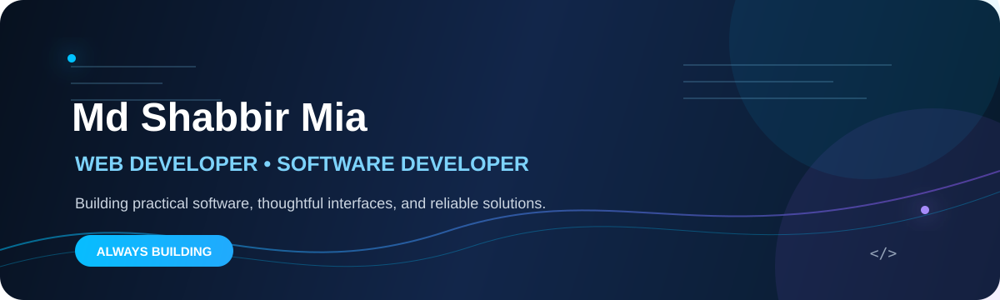
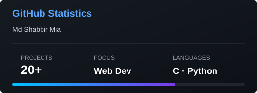
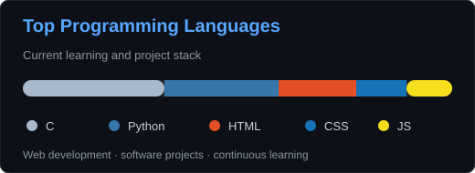
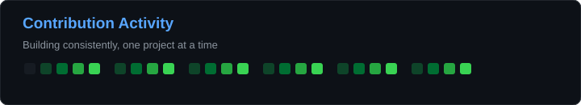

<!-- Professional GitHub Profile README for shabbirmai124 -->

  
    
  
  

    
    
    
  

  

---

## 👋 Hello, I'm Md Shabbir Mia

I am a **Web Developer and Software Developer** focused on creating useful, maintainable applications. I enjoy transforming complex problems into clear solutions, designing accessible interfaces, and building projects that combine strong engineering with practical user experiences.

- 🌐 Building modern **web applications** and responsive user experiences.
- 🐍 Developing practical projects with **Python**, **C**, **Kotlin**, and **JavaScript**.
- ⚙️ Interested in automation, software design, data handling, testing, and clean code.
- 📚 Learning through hands-on development, documentation, feedback, and collaboration.
- 🤝 Open to meaningful projects, learning opportunities, and constructive feedback.

## 🛠️ Skills & Technologies

| Category | Technologies |
| --- | --- |
| **Programming** | C, Python, JavaScript, Kotlin |
| **Web development** | HTML, CSS, React, responsive design |
| **Mobile development** | Kotlin, Jetpack Compose |
| **Tools** | Git, GitHub, Visual Studio Code |
| **Exploring** | Automation, AI assistants, privacy-first applications |

---

## 🚀 Recent Work

<table>
<tr>
<td width="50%" valign="top">
<h3>🤖 <a href="https://github.com/shabbirmai124/S.H.A.M.I.A.-Smart-Human-aligned-Assistant-Mindful-Interactive-Aid-App">S.H.A.M.I.A.</a></h3>

A futuristic, voice-enabled personal AI companion for hands-free control, natural conversation, and multi-model intelligence.

<strong>Focus:</strong> AI · Voice · Automation

</td>
<td width="50%" valign="top">
<h3>🏥 <a href="https://github.com/shabbirmai124/ShebaDoc-Bilingual-Telemedicine-Live-Chamber-Queue-Android-App">ShebaDoc</a></h3>

A bilingual telemedicine and appointment platform with doctor discovery and live chamber queue support for Bangladesh.

<strong>Focus:</strong> Kotlin · Healthcare · Accessibility

</td>
</tr>
<tr>
<td width="50%" valign="top">
<h3>📰 <a href="https://github.com/shabbirmai124/Stillpress-Anti-Doomscroll-News-Synthesizer">Stillpress</a></h3>

An anti-doomscrolling news platform that synthesizes clean articles and separates verified facts from differing perspectives.

<strong>Focus:</strong> React · TypeScript · AI

</td>
<td width="50%" valign="top">
<h3>💚 <a href="https://github.com/shabbirmai124/HarborLine">HarborLine</a></h3>

An offline-capable PWA for anonymous peer support, self-regulation, and humanitarian crisis aid with privacy-first design.

<strong>Focus:</strong> PWA · Privacy · Community

</td>
</tr>
</table>

**More projects:** [TicketGhor](https://github.com/shabbirmai124/TicketGhor-) · [TETRA](https://github.com/shabbirmai124/TETRA) · [Cadence](https://github.com/shabbirmai124/Cadence-Autonomous-Meeting-to-Workspace-Orchestrator) · [SyncSpace](https://github.com/shabbirmai124/SyncSpace) · [Event Management](https://github.com/shabbirmai124/Event-Managment)

---

## 📈 GitHub Activity

  
  
    
  

> These profile cards are stored in this repository, so they remain visible even when third-party statistics services are unavailable.

---

## 🎯 Current Goals

- Build complete, well-documented web and software projects.
- Strengthen data structures, algorithms, clean-code, and testing practices.
- Improve responsive UI design and modern application-development skills.
- Learn from collaboration and contribute to practical open-source work.
- Build privacy-focused, accessible, and AI-assisted tools.

## 📫 Let's Connect

  
Have an idea, feedback, or an interesting project? Feel free to reach out.

  

---

