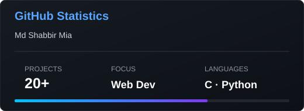
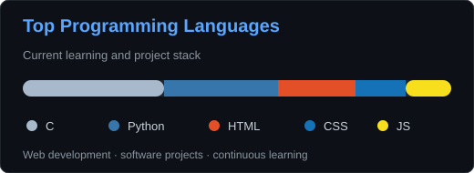
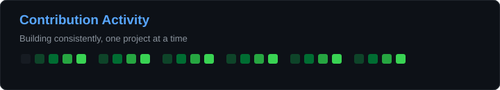

<!-- Professional GitHub Profile README for shabbirmai124 -->

  
    
  
  

    
    
    
    
  

  

---

## 👋 Hello, I'm Md Shabbir Mia

I am a **Web Developer and Software Developer** focused on creating useful, maintainable applications. I enjoy transforming complex problems into clear solutions, designing accessible interfaces, and turning ideas into practical software.

- 🌐 Building my skills in modern **web development** and responsive user experiences.
- 🐍 Developing practical projects with **Python** and structured applications with **C**.
- ⚙️ Interested in automation, software design, data handling, testing, and clean code.
- 📚 Learning through hands-on development, documentation, feedback, and collaboration.
- 🤝 Open to meaningful projects, learning opportunities, and constructive feedback.

## 🛠️ Skills & Technologies

| Category | Technologies |
| --- | --- |
| **Programming** | C, Python |
| **Web development** | HTML, CSS, JavaScript |
| **Tools** | Git, GitHub, Visual Studio Code |
| **Exploring** | Kotlin, React, responsive design, automation |

---

## 🚀 Featured Projects

<table><tr><td width="50%" valign="top"><h3>🤝 <a href="https://github.com/shabbirmai124/SyncSpace">SyncSpace</a></h3>
Unified team collaboration and mobile-platform project bridging enterprise communication and coordination.
</td><td width="50%" valign="top"><h3>📦 <a href="https://github.com/shabbirmai124/Event-Managment">Event Management</a></h3>
Organized event handling system with structured workflows, user interaction, and management tasks.
</td></tr>
<tr><td width="50%" valign="top"><h3>🏋️ <a href="https://github.com/shabbirmai124/Gym_management_System">Gym Management System</a></h3>
System for tracking members, services, scheduling, and operational management in a fitness environment.
</td><td width="50%" valign="top"><h3>📊 <a href="https://github.com/shabbirmai124/Market-Visit-Problem">Market Visit Problem</a></h3>
Algorithmic or logic-driven project focused on solving a practical optimization or traversal challenge.
</td></tr></table>

**More projects:** [Event Management](https://github.com/shabbirmai124/Event-Managment) · [Gym Management System](https://github.com/shabbirmai124/Gym_management_System) · [Market Visit Problem](https://github.com/shabbirmai124/Market-Visit-Problem)

---

## 📈 GitHub Activity

  
  
    
  

> These profile cards are stored in this repository, so they remain visible even when third-party statistics services are unavailable.

---

## 🎯 Current Goals

- Build complete, well-documented web and software projects.
- Strengthen data structures, algorithms, clean-code, and testing practices.
- Improve responsive UI design and modern web-development skills.
- Learn from collaboration and contribute to practical open-source work.

## 📫 Let's Connect

Have an idea, feedback, or an interesting project? Feel free to reach out.

---

